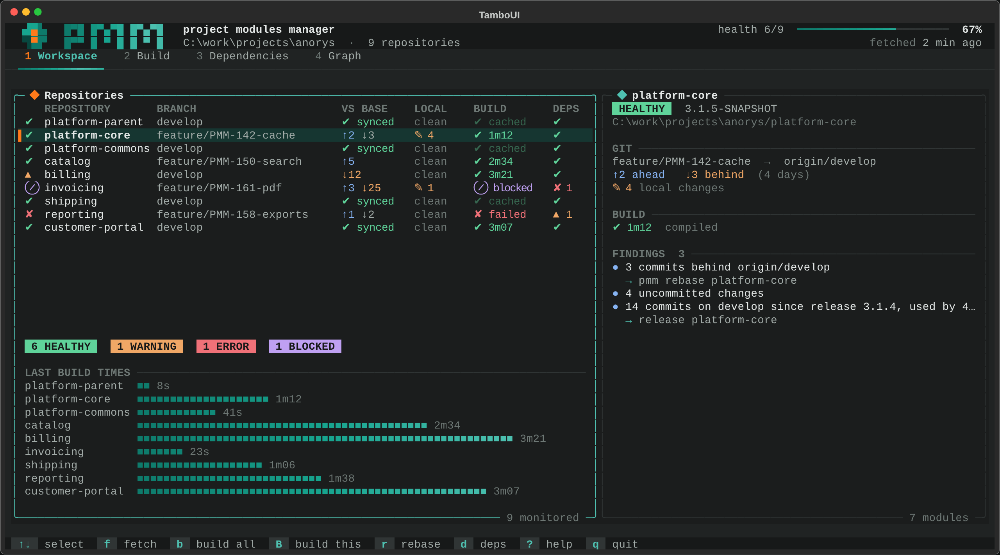
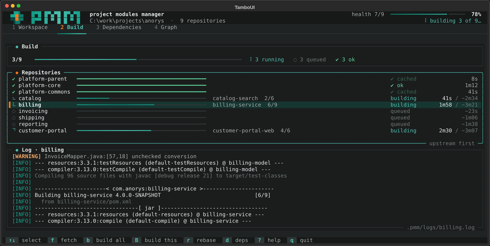
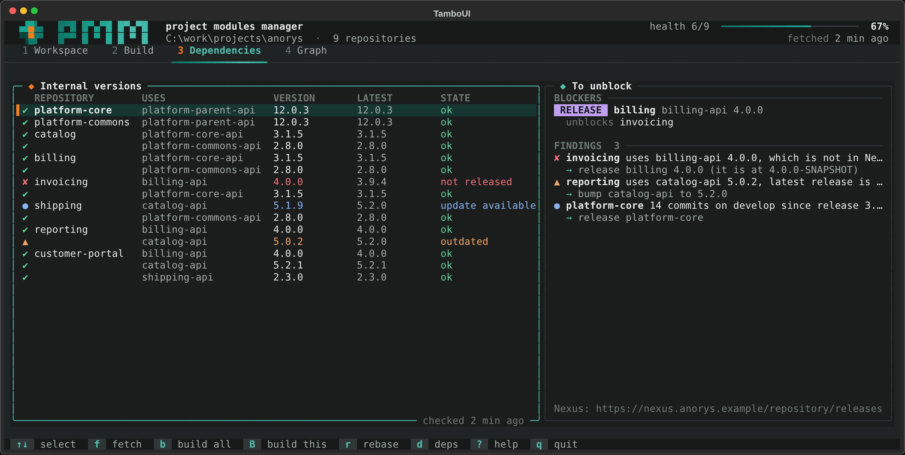
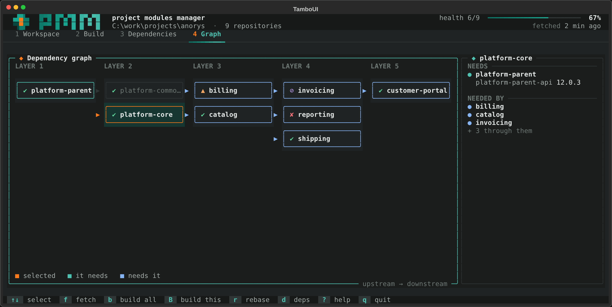

`pmm ui` (or `pmm` alone, in a terminal) opens an interactive dashboard: the whole workspace on one
screen, refreshed in the background, with the actions one key away. On start it reads the POMs and
the git status, then fetches and queries Nexus in the background.

## Tabs

| Tab | What it shows |
|---|---|
| `1` Workspace | One row per repository: branch, commits ahead of and behind the base branch, local changes, last build, dependency state; the selected repository in detail on the right, with its findings and what to do about them. |
| `2` Build | The builds live: a progress bar per repository (from Maven's reactor position, or the duration of the last build), the module being built, the estimated time, and the log of the selected repository as it is written. |
| `3` Dependencies | Every internal version against Nexus, the blockers and the releases that would unblock them. |
| `4` Graph | The repositories in build layers; what the selected one needs and what needs it. |

## Keys

| Key | Action |
|---|---|
| `↑` `↓` | Select a repository |
| `1`-`4`, `Tab` | Switch tab |
| `f` | Fetch every repository |
| `b` | Build everything (unchanged repositories come from the cache) |
| `B` | Build the selected repository without the cache |
| `r` | Rebase the selected branch: shows the plan and the predicted conflicts, asks first, then offers the `--force-with-lease` push |
| `d` | Check Nexus again |
| `?` | Help |
| `q` | Quit |

## Terminal support

- The dashboard needs a terminal of at least 80 x 24; Windows Terminal is recommended on Windows.
- `PMM_ASCII=1` replaces the Unicode symbols for old consoles.
- `NO_COLOR` turns colors off; every state keeps its symbol and its word.
- `pmm ui --demo` opens it on a made-up workspace of nine repositories with simulated git, Nexus and
  builds, to try it anywhere.

The visual rules are in the [dashboard style guide](../../development/tui-style-guide/).
