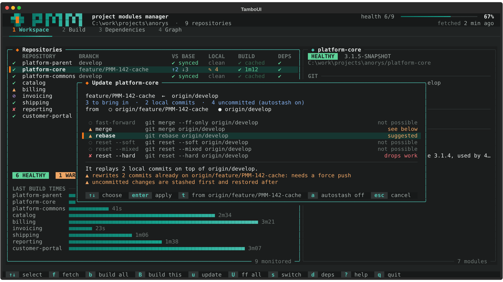
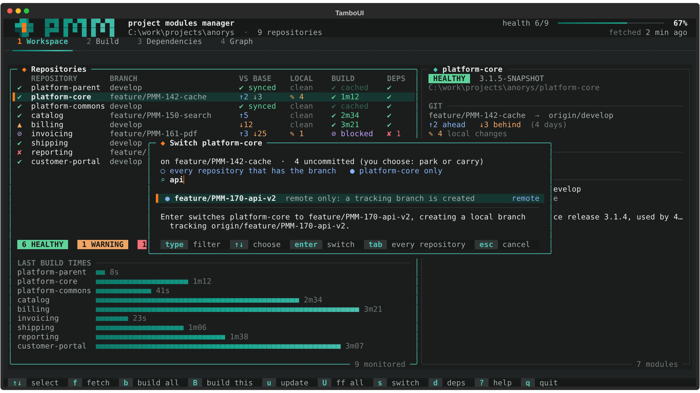
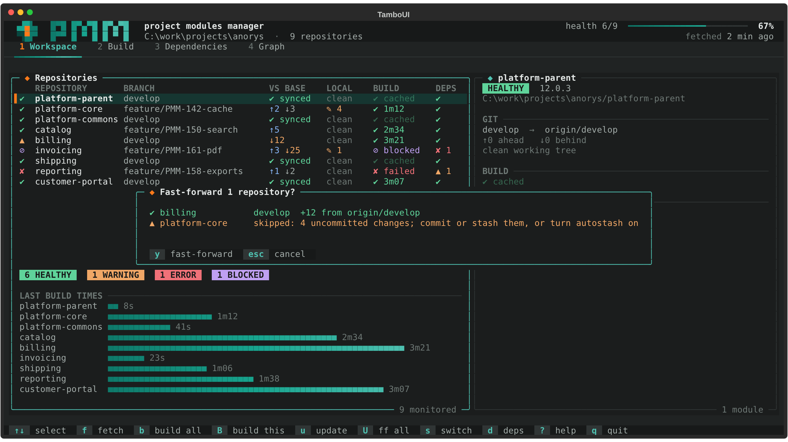

`pmm ui` (or `pmm` alone, in a terminal) opens an interactive dashboard: the whole workspace on one
screen, refreshed in the background, with the actions one key away. On start it reads the POMs and
the git status, then fetches and queries Nexus in the background.

## Tabs

| Tab | What it shows |
|---|---|
| `1` Workspace | One row per repository: branch, commits ahead of and behind the base branch, local changes, last build, dependency state; the selected repository in detail on the right, with its findings and what to do about them. |
| `2` Build | The builds live: a progress bar per repository (from Maven's reactor position, or the duration of the last build), the module being built, the estimated time, and the log of the selected repository as it is written. |
| `3` Dependencies | Every internal version against Nexus, the blockers and the releases that would unblock them. |
| `4` Graph | The repositories in build layers; what the selected one needs and what needs it. |

## Keys

| Key | Action |
|---|---|
| `↑` `↓` | Select a repository |
| `1`-`4`, `Tab` | Switch tab |
| `f` | Fetch every repository |
| `b` | Build everything (unchanged repositories come from the cache) |
| `B` | Build the selected repository without the cache |
| `u` | Update the selected branch: a menu of every strategy (fast-forward, merge, rebase, reset soft, mixed or hard) with what each would do; `t` switches between the upstream and the base branch, `a` turns autostash on |
| `r` | The same menu, from the base branch, with the rebase selected |
| `U` | Fast-forward every branch that only lacks commits of its upstream, after one confirmation |
| `s` | Switch branch: type to filter, `Tab` for every repository at once; uncommitted changes are parked or carried |
| `d` | Check Nexus again |
| `?` | Help |
| `q` | Quit |

## Updating and switching branches

`u` opens the update menu of the selected repository. Each strategy says what it would do, or why it
cannot run; the one of `branches.strategies` is selected. A strategy that drops work (a hard reset)
asks again, and after a rebase or a reset that rewrote published commits, the dashboard offers the
`--force-with-lease` push (never for a push-protected branch). See
[Branches, updates and switching](../rebasing/) for the rules.

`s` lists the branches, local ones first, then the remote ones without a local copy. With uncommitted
changes, it asks whether to **park** them (stashed with the branch you leave, back when you return)
or **carry** them to the new branch. Typing a name that does not exist offers to create it from the
base branch.

## Terminal support

- The dashboard needs a terminal of at least 80 x 24; Windows Terminal is recommended on Windows.
- `PMM_ASCII=1` replaces the Unicode symbols for old consoles.
- `NO_COLOR` turns colors off; every state keeps its symbol and its word.
- `pmm ui --demo` opens it on a made-up workspace of nine repositories with simulated git, Nexus and
  builds, to try it anywhere.

The visual rules are in the [dashboard style guide](../../development/tui-style-guide/).
